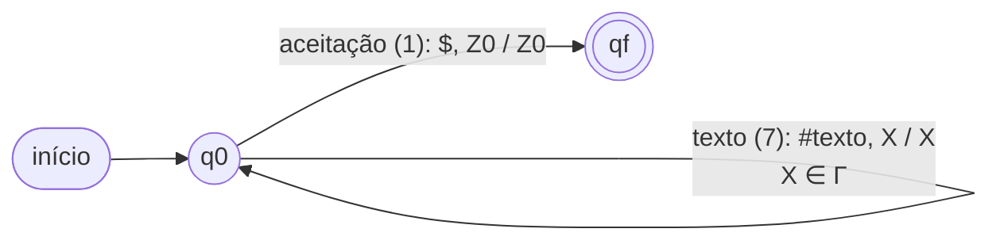
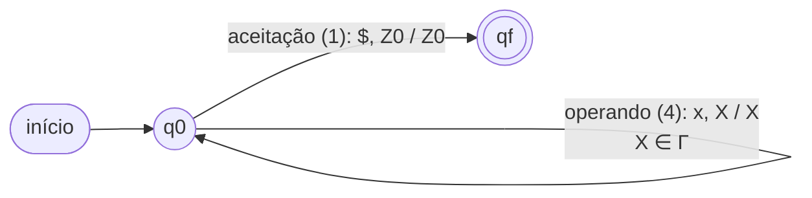

# Definição formal dos autômatos

Este documento apresenta a **teoria** por trás do validador e a **definição formal completa**
dos dois Autômatos com Pilha Determinísticos (APD) do projeto. Ele segue exatamente as
convenções de [ARQUITETURA.md](ARQUITETURA.md), que é o contrato do projeto: se houver
qualquer divergência, vale o ARQUITETURA.md.

> **Como ler as notações deste documento**
>
> - Os símbolos de entrada aparecem sempre entre crases: `<div>`, `</p>`, `#texto`, `(`, `x`, `$`.
> - Uma pilha é escrita como uma cadeia com o **topo à esquerda**: `P DIV Z0` significa
>   P no topo, depois DIV, e Z0 no fundo. É a mesma convenção do código (`pilha[0]` é o topo).
> - ε é a palavra vazia (`None` em Python, `null` no JSON).
> - aⁿ significa o símbolo a repetido n vezes. Exemplo: `(`³ = `(((`.

## Sumário

1. [O que é um APD](#1-o-que-é-um-apd)
2. [Por que um AFD não basta](#2-por-que-um-afd-não-basta)
3. [O marcador de fim `$`](#3-o-marcador-de-fim-)
4. [Autômato 1: tags XML/HTML](#4-autômato-1-tags-xmlhtml)
5. [Autômato 2: expressões balanceadas](#5-autômato-2-expressões-balanceadas)
6. [Verificação do determinismo](#6-verificação-do-determinismo)
7. [Rastreamentos passo a passo](#7-rastreamentos-passo-a-passo)
8. [Tipos de falha](#8-tipos-de-falha)
9. [Glossário](#9-glossário)

---

## 1. O que é um APD

### 1.1 A 7-tupla

Um **Autômato com Pilha Determinístico** é uma 7-tupla

> **M = (Q, Σ, Γ, δ, q0, Z0, F)**

| Componente | Nome | Significado | Campo no JSON |
|---|---|---|---|
| Q | conjunto de estados | conjunto finito de estados de controle | `estados` |
| Σ | alfabeto de entrada | conjunto finito de símbolos que podem aparecer na fita | `alfabeto_entrada` |
| Γ | alfabeto da pilha | conjunto finito de símbolos que podem ser guardados na pilha | `alfabeto_pilha` |
| δ | função de transição | regras de movimento (ver 1.2) | `transicoes` |
| q0 ∈ Q | estado inicial | estado em que o autômato começa | `estado_inicial` |
| Z0 ∈ Γ | símbolo inicial da pilha | único símbolo na pilha no início; marca o fundo | `simbolo_inicial_pilha` |
| F ⊆ Q | estados finais | estados de aceitação | `estados_finais` |

A diferença para um autômato finito é a **pilha**: uma memória ilimitada, mas acessada apenas
pelo topo (o último símbolo guardado é o primeiro a sair, LIFO).

### 1.2 A função de transição

> **δ: Q × (Σ ∪ {ε}) × Γ → Q × Γ\***
>
> (função parcial: pode estar indefinida para alguns argumentos)

Ler a transição **δ(q, a, X) = (p, γ)**:

> "No estado q, lendo o símbolo a na fita e com X no topo da pilha, vá para o estado p e
> **troque o topo X pela cadeia γ**."

- Se a ∈ Σ, o símbolo a é **consumido** (o cabeçote avança).
- Se a = ε, é uma **ε-transição**: o autômato muda de configuração **sem** consumir entrada.
- A cadeia γ ∈ Γ\* é escrita com o **novo topo à esquerda** (no código, `empilha[0]` é o novo topo).

Os quatro casos de γ correspondem ao enum `Acao` de `apd/modelos.py`:

| γ | Efeito na pilha | `Acao` | Exemplo |
|---|---|---|---|
| Y X | empilha Y (cresce 1) | `EMPILHA` | δ(q0, `<div>`, BODY) = (q0, DIV BODY) |
| ε | desempilha X (diminui 1) | `DESEMPILHA` | δ(q0, `</p>`, P) = (q0, ε) |
| X | mantém a pilha | `MANTEM` | δ(q0, `#texto`, DIV) = (q0, DIV) |
| outra | substitui o topo | `SUBSTITUI` | (não ocorre nos nossos autômatos) |

### 1.3 Condições de determinismo

M é **determinístico** se, para todo q ∈ Q e todo X ∈ Γ:

1. **No máximo uma transição** para cada trio (q, a, X), com a ∈ Σ ∪ {ε}.
   Ou seja, |δ(q, a, X)| ≤ 1.
2. **Nenhum conflito com ε**: se δ(q, ε, X) está definida, então δ(q, a, X) **não** está
   definida para nenhum a ∈ Σ.

Juntas, as duas condições garantem que, em qualquer configuração, existe **no máximo um
movimento possível**. O autômato nunca precisa "adivinhar" qual caminho seguir. O
`APD.validar()` do projeto verifica exatamente essas duas condições e levanta
`DefinicaoInvalidaError` se alguma for violada.

### 1.4 Configuração (descrição instantânea) e a relação ⊢

Uma **configuração** é uma tripla **(q, w, γ)** onde:

- q ∈ Q é o estado atual;
- w ∈ Σ\* é a parte da entrada **ainda não lida**;
- γ ∈ Γ\* é o conteúdo da pilha, **topo à esquerda**.

No código, a dataclass `Configuracao(estado, posicao, pilha)` guarda w de forma indireta:
w = `fita[posicao:]`.

A relação de **movimento** ⊢ ("leva em um passo") é definida por:

> (q, a w, X β) ⊢ (p, w, γ β)  se δ(q, a, X) = (p, γ),  com a ∈ Σ ∪ {ε}, X ∈ Γ, β ∈ Γ\*

Isto é: só o topo X é examinado e substituído por γ; o resto da pilha (β) fica intocado. Se
a = ε, então a w = w e nada é consumido.

- ⊢\* é o fecho reflexivo e transitivo de ⊢ ("leva em zero ou mais passos").
- Cada objeto `Passo` registrado pelo `APD.executar` é exatamente um movimento
  `antes ⊢ depois`.
- Se nenhuma transição se aplica a uma configuração C, escrevemos C ⊬ e dizemos que o
  autômato **trava**.

### 1.5 Aceitação por estado final

A linguagem reconhecida por M (aceitação **por estado final**) é:

> **L(M) = { w ∈ Σ\* | (q0, w, Z0) ⊢\* (p, ε, γ) para algum p ∈ F e algum γ ∈ Γ\* }**

Duas observações importantes:

- A entrada precisa ser **lida por completo** (a segunda componente termina em ε).
- O conteúdo final da pilha (γ) **não importa** para o critério. É por isso que precisamos
  garantir, pelo projeto das transições, que só se chega a um estado final com a pilha
  "vazia" (apenas Z0). Isso é feito com o marcador `$` (seção 3).

Nos nossos autômatos, Z0 **nunca é desempilhado**: ele marca o fundo, e "pilha vazia"
significa "pilha contendo apenas Z0".

---

## 2. Por que um AFD não basta

### 2.1 Intuição

Para validar `((( … )))` é preciso **contar** quantos parênteses estão abertos, e essa
profundidade não tem limite. Um AFD tem um número **finito** de estados, então só consegue
distinguir uma quantidade finita de profundidades. A pilha resolve o problema: cada abertura
empilha um símbolo e cada fechamento desempilha um.

### 2.2 Prova pelo Lema do Bombeamento

> **Lema do Bombeamento (linguagens regulares).** Se L é regular, existe uma constante
> p ≥ 1 tal que toda cadeia s ∈ L com |s| ≥ p pode ser escrita como s = u v w com:
> (i) |u v| ≤ p; (ii) |v| ≥ 1; (iii) u vⁱ w ∈ L para todo i ≥ 0.

(Usamos u, v, w em vez do tradicional x, y, z para não confundir com o símbolo `x` do
autômato de expressões.)

> **Proposição.** L = { `(`ⁿ `)`ⁿ | n ≥ 0 } não é regular.

**Prova.** Suponha, por absurdo, que L é regular, e seja p a constante do lema.

1. Escolha s = `(`ᵖ `)`ᵖ. Então s ∈ L e |s| = 2p ≥ p.
2. Seja s = u v w uma decomposição qualquer com |u v| ≤ p e |v| ≥ 1.
3. Como os p primeiros símbolos de s são todos `(` e |u v| ≤ p, a parte v contém **apenas**
   `(`. Logo v = `(`ᵏ para algum k ≥ 1.
4. Bombeando com i = 2: u v² w = `(`ᵖ⁺ᵏ `)`ᵖ.
5. Como k ≥ 1, essa cadeia tem mais `(` do que `)`, portanto u v² w ∉ L.
6. Isso contradiz o item (iii) do lema. Logo L não é regular. ∎

### 2.3 Consequência para as linguagens do projeto

Seja L_expr a linguagem das expressões balanceadas (sobre `(` `)` `[` `]` `{` `}` `x`).
Se L_expr fosse regular, então

> L_expr ∩ `(`\* `)`\* = { `(`ⁿ `)`ⁿ | n ≥ 0 }

também seria regular, porque linguagens regulares são **fechadas sob interseção** e
`(`\* `)`\* é regular. Isso contradiz a Proposição. Logo L_expr **não é regular**.

O mesmo argumento vale para as tags: L_xml ∩ `<div>`\* `</div>`\* = { `<div>`ⁿ `</div>`ⁿ | n ≥ 0 },
que não é regular pela mesma prova (troque `(` por `<div>` e `)` por `</div>`).
Portanto **nenhum AFD** consegue validar o aninhamento de tags, e o uso de um autômato
com pilha é necessário, não apenas conveniente.

### 2.4 Gramáticas livres de contexto (LLC)

O aninhamento balanceado é o exemplo clássico de **linguagem livre de contexto** (LLC): é
gerado por uma gramática livre de contexto (GLC) e reconhecido por um autômato com pilha.

**GLC das tags** (G_xml). Para cada tag t ∈ T = {html, body, div, p, ul, li}:

```
S → <t> S </t> S        (uma produção para cada t ∈ T: 6 produções)
S → #texto S
S → ε
```

Escrevendo todas: `S → <html> S </html> S | <body> S </body> S | <div> S </div> S | <p> S </p> S | <ul> S </ul> S | <li> S </li> S | #texto S | ε`.

Leitura da produção `S → <t> S </t> S`: "um documento válido pode ser um elemento `t`
com um documento válido dentro, seguido de outro documento válido". Exemplo de derivação
da entrada do rastreamento 7.1:

```
S ⇒ <div> S </div> S
  ⇒ <div> <p> S </p> S </div> S
  ⇒ <div> <p> #texto S </p> S </div> S
  ⇒ <div> <p> #texto </p> S </div> S        (S → ε)
  ⇒ <div> <p> #texto </p> </div> S          (S → ε)
  ⇒ <div> <p> #texto </p> </div>            (S → ε)
```

**GLC das expressões** (G_expr):

```
E → ( E ) E | [ E ] E | { E } E | x E | ε
```

Essas linguagens são versões da **linguagem de Dyck** (palavras de parênteses balanceados),
com 6 pares (tags) ou 3 pares (expressões), acrescidas de um símbolo "neutro" (`#texto`
ou `x`) que pode aparecer em qualquer lugar. Como são reconhecidas por um APD, são mais
do que LLC: são **linguagens livres de contexto determinísticas** (LLCD).

Relação entre os níveis da hierarquia usados aqui:

> Regulares ⊊ LLC determinísticas ⊊ LLC

L_xml e L_expr estão no meio: não são regulares (2.2 e 2.3), mas são determinísticas
(seções 4 a 6).

---

## 3. O marcador de fim `$`

### 3.1 O problema: aceitar sem ε quebraria o determinismo

Considere a ideia mais natural para aceitar: "quando a pilha estiver só com Z0, a entrada
pode ter acabado; vá para qf". Isso seria uma ε-transição:

> δ(q0, ε, Z0) = (qf, Z0)

Mas, no mesmo estado q0 e com o mesmo topo Z0, também precisamos de
δ(q0, `<div>`, Z0) = (q0, DIV Z0) (para abrir um elemento na raiz), δ(q0, `#texto`, Z0) etc.
Ter as duas **viola a condição 2 do determinismo** (seção 1.3): o autômato não saberia se
deve parar ou continuar lendo. Um AP **não determinístico** poderia "adivinhar" que a entrada
acabou; um APD não pode.

Tornar q0 final também não funciona: a aceitação é por estado final e **ignora a pilha**,
então `<div>` sozinho seria aceito (fita lida inteira, estado q0 ∈ F, pilha `DIV Z0`).

### 3.2 A solução: um símbolo que só aparece no fim

O tokenizador acrescenta `$` (constante `MARCADOR_FIM`) como **último token de toda fita**.
Com isso, a aceitação vira uma transição que **lê** um símbolo:

> δ(q0, `$`, Z0) = (qf, Z0)

Ela só pode acontecer quando **duas** condições valem ao mesmo tempo:

- a entrada acabou (só existe `$` no fim da fita), **e**
- a pilha está "vazia" (topo = Z0, isto é, todas as aberturas foram fechadas).

Nenhuma ε-transição é necessária, então o determinismo é preservado.

### 3.3 Ligação com o diagnóstico

Se o APD lê `$` e o topo **não** é Z0, não há transição definida e ele trava. O motivo é
exato e conhecido: sobrou algo aberto. É a regra 3 do diagnóstico (ARQUITETURA.md, §9),
que gera a falha `PILHA_NAO_VAZIA` com a mensagem **"pilha não vazia ao fim da entrada"**
(ver o rastreamento 7.3).

### 3.4 A linguagem efetivamente reconhecida

Como `$` ∈ Σ, a linguagem que o APD reconhece formalmente é a linguagem desejada
**concatenada com `$`**:

> **L(M_xml) = L(G_xml) · {`$`}**  e  **L(M_expr) = L(G_expr) · {`$`}**

Ou seja, um texto é válido se e somente se a sua fita de tokens w (sem o marcador) satisfaz
w `$` ∈ L(M). Como o tokenizador sempre acrescenta `$`, isso é transparente para o usuário.

> **Observação.** O `$` é uma escolha de projeto, não uma limitação do modelo: a linguagem
> de Dyck também é LLC determinística sem marcador, mas o APD precisaria de mais estados e
> de ε-transições sem conflito. Com `$` o autômato fica com apenas 2 estados, sem nenhuma
> ε-transição, e o diagnóstico de "pilha não vazia" fica imediato.

---

## 4. Autômato 1: tags XML/HTML

Arquivo: `automatos/xml_tags.json` · tokenizador: `"xml"`

### 4.1 A tupla M_xml = (Q, Σ, Γ, δ, q0, Z0, F)

Conjunto de tags suportadas: **T = {html, body, div, p, ul, li}**.
Para cada tag t ∈ T, seu **símbolo de pilha** é Yₜ:

| Tag t | Abertura | Fechamento | Yₜ (símbolo de pilha) |
|---|---|---|---|
| html | `<html>` | `</html>` | HTML |
| body | `<body>` | `</body>` | BODY |
| div | `<div>` | `</div>` | DIV |
| p | `<p>` | `</p>` | P |
| ul | `<ul>` | `</ul>` | UL |
| li | `<li>` | `</li>` | LI |

- **Q** = {q0, qf}
- **Σ** = {`<html>`, `</html>`, `<body>`, `</body>`, `<div>`, `</div>`, `<p>`, `</p>`, `<ul>`, `</ul>`, `<li>`, `</li>`, `#texto`, `$`}, com **|Σ| = 14** (6 aberturas + 6 fechamentos + `#texto` + `$`)
- **Γ** = {Z0, HTML, BODY, DIV, P, UL, LI}, com **|Γ| = 7**
- **q0** = q0 (estado inicial)
- **Z0** = Z0 (símbolo inicial da pilha)
- **F** = {qf}
- **δ**: 56 transições, definidas abaixo.

### 4.2 δ em forma esquemática

| Grupo | Regra | Quantidade | `Acao` |
|---|---|---|---|
| Abertura | δ(q0, `<t>`, X) = (q0, Yₜ X), para todo t ∈ T e todo X ∈ Γ | 6 × 7 = 42 | `EMPILHA` |
| Fechamento | δ(q0, `</t>`, Yₜ) = (q0, ε), para todo t ∈ T | 6 | `DESEMPILHA` |
| Texto | δ(q0, `#texto`, X) = (q0, X), para todo X ∈ Γ | 7 | `MANTEM` |
| Aceitação | δ(q0, `$`, Z0) = (qf, Z0) | 1 | `MANTEM` |
| **Total** | | **56** | |

Em palavras:

- **Abertura**: ao ler `<t>`, qualquer que seja o topo, empilha Yₜ.
- **Fechamento**: `</t>` só pode ser lido se o topo for exatamente Yₜ (a tag aberta mais
  recentemente é t); nesse caso, desempilha.
- **Texto**: `#texto` não altera a pilha (texto é permitido em qualquer nível).
- **Aceitação**: `$` com a pilha vazia (topo Z0) leva ao estado final qf.
- Não há nenhuma transição saindo de qf, e não há nenhuma ε-transição.

### 4.3 Tabela completa de δ (56 transições)

**Abertura (42 transições)**: δ(q0, `<t>`, X) = (q0, Yₜ X)

| # | δ(q, a, X) | = (p, γ) |
|---|---|---|
| 1 | δ(q0, `<html>`, Z0) | (q0, HTML Z0) |
| 2 | δ(q0, `<html>`, HTML) | (q0, HTML HTML) |
| 3 | δ(q0, `<html>`, BODY) | (q0, HTML BODY) |
| 4 | δ(q0, `<html>`, DIV) | (q0, HTML DIV) |
| 5 | δ(q0, `<html>`, P) | (q0, HTML P) |
| 6 | δ(q0, `<html>`, UL) | (q0, HTML UL) |
| 7 | δ(q0, `<html>`, LI) | (q0, HTML LI) |
| 8 | δ(q0, `<body>`, Z0) | (q0, BODY Z0) |
| 9 | δ(q0, `<body>`, HTML) | (q0, BODY HTML) |
| 10 | δ(q0, `<body>`, BODY) | (q0, BODY BODY) |
| 11 | δ(q0, `<body>`, DIV) | (q0, BODY DIV) |
| 12 | δ(q0, `<body>`, P) | (q0, BODY P) |
| 13 | δ(q0, `<body>`, UL) | (q0, BODY UL) |
| 14 | δ(q0, `<body>`, LI) | (q0, BODY LI) |
| 15 | δ(q0, `<div>`, Z0) | (q0, DIV Z0) |
| 16 | δ(q0, `<div>`, HTML) | (q0, DIV HTML) |
| 17 | δ(q0, `<div>`, BODY) | (q0, DIV BODY) |
| 18 | δ(q0, `<div>`, DIV) | (q0, DIV DIV) |
| 19 | δ(q0, `<div>`, P) | (q0, DIV P) |
| 20 | δ(q0, `<div>`, UL) | (q0, DIV UL) |
| 21 | δ(q0, `<div>`, LI) | (q0, DIV LI) |
| 22 | δ(q0, `<p>`, Z0) | (q0, P Z0) |
| 23 | δ(q0, `<p>`, HTML) | (q0, P HTML) |
| 24 | δ(q0, `<p>`, BODY) | (q0, P BODY) |
| 25 | δ(q0, `<p>`, DIV) | (q0, P DIV) |
| 26 | δ(q0, `<p>`, P) | (q0, P P) |
| 27 | δ(q0, `<p>`, UL) | (q0, P UL) |
| 28 | δ(q0, `<p>`, LI) | (q0, P LI) |
| 29 | δ(q0, `<ul>`, Z0) | (q0, UL Z0) |
| 30 | δ(q0, `<ul>`, HTML) | (q0, UL HTML) |
| 31 | δ(q0, `<ul>`, BODY) | (q0, UL BODY) |
| 32 | δ(q0, `<ul>`, DIV) | (q0, UL DIV) |
| 33 | δ(q0, `<ul>`, P) | (q0, UL P) |
| 34 | δ(q0, `<ul>`, UL) | (q0, UL UL) |
| 35 | δ(q0, `<ul>`, LI) | (q0, UL LI) |
| 36 | δ(q0, `<li>`, Z0) | (q0, LI Z0) |
| 37 | δ(q0, `<li>`, HTML) | (q0, LI HTML) |
| 38 | δ(q0, `<li>`, BODY) | (q0, LI BODY) |
| 39 | δ(q0, `<li>`, DIV) | (q0, LI DIV) |
| 40 | δ(q0, `<li>`, P) | (q0, LI P) |
| 41 | δ(q0, `<li>`, UL) | (q0, LI UL) |
| 42 | δ(q0, `<li>`, LI) | (q0, LI LI) |

**Fechamento (6 transições)**: δ(q0, `</t>`, Yₜ) = (q0, ε)

| # | δ(q, a, X) | = (p, γ) |
|---|---|---|
| 43 | δ(q0, `</html>`, HTML) | (q0, ε) |
| 44 | δ(q0, `</body>`, BODY) | (q0, ε) |
| 45 | δ(q0, `</div>`, DIV) | (q0, ε) |
| 46 | δ(q0, `</p>`, P) | (q0, ε) |
| 47 | δ(q0, `</ul>`, UL) | (q0, ε) |
| 48 | δ(q0, `</li>`, LI) | (q0, ε) |

**Texto (7 transições)**: δ(q0, `#texto`, X) = (q0, X)

| # | δ(q, a, X) | = (p, γ) |
|---|---|---|
| 49 | δ(q0, `#texto`, Z0) | (q0, Z0) |
| 50 | δ(q0, `#texto`, HTML) | (q0, HTML) |
| 51 | δ(q0, `#texto`, BODY) | (q0, BODY) |
| 52 | δ(q0, `#texto`, DIV) | (q0, DIV) |
| 53 | δ(q0, `#texto`, P) | (q0, P) |
| 54 | δ(q0, `#texto`, UL) | (q0, UL) |
| 55 | δ(q0, `#texto`, LI) | (q0, LI) |

**Aceitação (1 transição)**

| # | δ(q, a, X) | = (p, γ) |
|---|---|---|
| 56 | δ(q0, `$`, Z0) | (qf, Z0) |

Conferência: 42 + 6 + 7 + 1 = **56**.

No JSON, cada linha vira um objeto, por exemplo (transições 15, 45 e 56):

```json
{"origem": "q0", "le": "<div>",  "topo": "Z0",  "destino": "q0", "empilha": ["DIV", "Z0"]},
{"origem": "q0", "le": "</div>", "topo": "DIV", "destino": "q0", "empilha": []},
{"origem": "q0", "le": "$",      "topo": "Z0",  "destino": "qf", "empilha": ["Z0"]}
```

### 4.4 Rótulos da pilha (`rotulos_pilha`)

Usados pelo diagnóstico para escrever mensagens legíveis (DIV vira `<div>`):

```json
"rotulos_pilha": {
  "Z0": "fundo da pilha",
  "HTML": "<html>",
  "BODY": "<body>",
  "DIV": "<div>",
  "P": "<p>",
  "UL": "<ul>",
  "LI": "<li>"
}
```

### 4.5 Diagrama de estados

Rótulos no formato **"a, X / γ"** = "lê a, com X no topo, troca X por γ". Os laços em q0 estão
agrupados por esquema (t ∈ T, X ∈ Γ).



Legenda: círculo duplo = estado final (qf ∈ F). O estado qf não tem transições de saída.

### 4.6 Correção do autômato (esboço)

> **Invariante.** Para toda cadeia u sobre Σ \ {`$`}, a execução de M_xml sobre u **não trava**
> se e somente se todo fechamento de u corresponde à tag aberta mais recentemente ainda não
> fechada. Nesse caso, (q0, u, Z0) ⊢\* (q0, ε, Y_{t_k} … Y_{t_1} Z0), onde t_1, …, t_k são as
> tags abertas e ainda não fechadas, **da mais externa (t_1) para a mais interna (t_k)**.

*Esboço da prova* (indução no comprimento de u): para u = ε vale com k = 0. Suponha que vale
para u e considere u a:

- a = `<t>`: a transição de abertura existe para qualquer topo e empilha Yₜ; agora t é a tag
  aberta mais interna.
- a = `#texto`: a pilha não muda, e o conjunto de tags abertas também não.
- a = `</t>`: só existe transição se o topo for Yₜ, isto é, se t_k = t; nesse caso Yₜ sai da
  pilha. Se t_k ≠ t (ou k = 0), o APD trava, exatamente como exige o invariante.

Ao final, lendo `$`: a transição 56 só existe com topo Z0, ou seja, k = 0. Portanto
**u `$` ∈ L(M_xml) ⇔ u é balanceada e bem aninhada ⇔ u ∈ L(G_xml)**.

### 4.7 Limitações (o que este autômato NÃO verifica)

O autômato reconhece a linguagem de Dyck sobre os **6 pares** de tags, mais o símbolo neutro
`#texto`. Ele valida **apenas balanceamento e aninhamento**, não a semântica do HTML:

- `<li>` fora de `<ul>` é aceito (ex.: `<div><li>a</li></div>`);
- `<html>` dentro de `<p>` é aceito (ex.: `<p><html></html></p>`);
- várias raízes são aceitas (ex.: `<p>a</p><p>b</p>`);
- texto fora de qualquer tag é aceito (ex.: `Olá`), assim como a entrada vazia (fita só com `$`).

Tags **fora de T** (por exemplo `<table>`, `<span>` ou a auto-fechada `<br/>`) são
**rejeitadas**, pois o tokenizador as gera como símbolos que **não pertencem a Σ** (falha
`SIMBOLO_FORA_DO_ALFABETO`). Atributos são ignorados pelo tokenizador (`<div class="a">` vira
`<div>`), e comentários `<!-- … -->` são descartados antes de chegar ao APD.

---

## 5. Autômato 2: expressões balanceadas

Arquivo: `automatos/expressoes.json` · tokenizador: `"expressao"`

### 5.1 A tupla M_expr = (Q, Σ, Γ, δ, q0, Z0, F)

Pares de delimitadores. Para cada abertura a, ā é o fechamento correspondente e Yₐ o símbolo
de pilha:

| Abertura a | Fechamento ā | Yₐ (símbolo de pilha) |
|---|---|---|
| `(` | `)` | PAR |
| `[` | `]` | COL |
| `{` | `}` | CHA |

- **Q** = {q0, qf}
- **Σ** = {`(`, `)`, `[`, `]`, `{`, `}`, `x`, `$`}, com **|Σ| = 8**
- **Γ** = {Z0, PAR, COL, CHA}, com **|Γ| = 4**
- **q0** = q0; **Z0** = Z0; **F** = {qf}
- **δ**: 20 transições, definidas abaixo.

O símbolo `x` representa um **operando**: o tokenizador transforma cada trecho contínuo de
caracteres que não são delimitadores nem espaços (por exemplo `2+3`, `a*b`) em um único `x`.

### 5.2 δ em forma esquemática

| Grupo | Regra | Quantidade | `Acao` |
|---|---|---|---|
| Abertura | δ(q0, a, X) = (q0, Yₐ X), para a ∈ {`(`, `[`, `{`} e X ∈ Γ | 3 × 4 = 12 | `EMPILHA` |
| Fechamento | δ(q0, ā, Yₐ) = (q0, ε), para cada par | 3 | `DESEMPILHA` |
| Operando | δ(q0, `x`, X) = (q0, X), para X ∈ Γ | 4 | `MANTEM` |
| Aceitação | δ(q0, `$`, Z0) = (qf, Z0) | 1 | `MANTEM` |
| **Total** | | **20** | |

### 5.3 Tabela completa de δ (20 transições)

| # | Grupo | δ(q, a, X) | = (p, γ) |
|---|---|---|---|
| 1 | abertura | δ(q0, `(`, Z0) | (q0, PAR Z0) |
| 2 | abertura | δ(q0, `(`, PAR) | (q0, PAR PAR) |
| 3 | abertura | δ(q0, `(`, COL) | (q0, PAR COL) |
| 4 | abertura | δ(q0, `(`, CHA) | (q0, PAR CHA) |
| 5 | abertura | δ(q0, `[`, Z0) | (q0, COL Z0) |
| 6 | abertura | δ(q0, `[`, PAR) | (q0, COL PAR) |
| 7 | abertura | δ(q0, `[`, COL) | (q0, COL COL) |
| 8 | abertura | δ(q0, `[`, CHA) | (q0, COL CHA) |
| 9 | abertura | δ(q0, `{`, Z0) | (q0, CHA Z0) |
| 10 | abertura | δ(q0, `{`, PAR) | (q0, CHA PAR) |
| 11 | abertura | δ(q0, `{`, COL) | (q0, CHA COL) |
| 12 | abertura | δ(q0, `{`, CHA) | (q0, CHA CHA) |
| 13 | fechamento | δ(q0, `)`, PAR) | (q0, ε) |
| 14 | fechamento | δ(q0, `]`, COL) | (q0, ε) |
| 15 | fechamento | δ(q0, `}`, CHA) | (q0, ε) |
| 16 | operando | δ(q0, `x`, Z0) | (q0, Z0) |
| 17 | operando | δ(q0, `x`, PAR) | (q0, PAR) |
| 18 | operando | δ(q0, `x`, COL) | (q0, COL) |
| 19 | operando | δ(q0, `x`, CHA) | (q0, CHA) |
| 20 | aceitação | δ(q0, `$`, Z0) | (qf, Z0) |

Conferência: 12 + 3 + 4 + 1 = **20**.

### 5.4 Rótulos da pilha (`rotulos_pilha`)

```json
"rotulos_pilha": {
  "Z0": "fundo da pilha",
  "PAR": "(",
  "COL": "[",
  "CHA": "{"
}
```

### 5.5 Diagrama de estados



### 5.6 Correção e limitações

O mesmo invariante da seção 4.6 vale aqui, trocando tags por delimitadores: o APD não trava
enquanto cada fechamento corresponde à abertura pendente mais recente, e a pilha guarda as
aberturas pendentes (a mais interna no topo). Logo **w `$` ∈ L(M_expr) ⇔ w ∈ L(G_expr)**.

O autômato verifica **somente o balanceamento** dos delimitadores. Ele não verifica a
gramática aritmética: como todo trecho sem delimitadores vira `x`, entradas como `(+)` ou
`(2+)` são aceitas, pois viram `( x )`.

---

## 6. Verificação do determinismo

Vamos verificar as duas condições da seção 1.3 para os dois autômatos.

**Condição 2 (sem conflito com ε).** Nenhum dos dois autômatos tem ε-transição: todas as
transições leem um símbolo de Σ (no JSON, nenhum `"le"` é `null`). Logo a hipótese
"δ(q, ε, X) está definida" nunca é verdadeira e a condição vale trivialmente.

**Condição 1 (no máximo uma transição por (q, a, X)).** Basta mostrar que as chaves
(q, a, X) das transições são todas distintas:

- **Estado qf**: nenhuma transição parte de qf, então não há conflito ali.
- **Estado q0**: os quatro grupos usam **símbolos de entrada disjuntos**:

| Grupo | Símbolos lidos (XML) | Símbolos lidos (expressões) |
|---|---|---|
| Abertura | `<html>` `<body>` `<div>` `<p>` `<ul>` `<li>` | `(` `[` `{` |
| Fechamento | `</html>` `</body>` `</div>` `</p>` `</ul>` `</li>` | `)` `]` `}` |
| Texto/operando | `#texto` | `x` |
| Aceitação | `$` | `$` |

  Então duas transições de grupos diferentes nunca têm a mesma chave. Dentro de cada grupo:
  - **abertura**: a chave (q0, `<t>`, X) é determinada pelo par (t, X), e cada par aparece uma
    única vez (6 × 7 = 42 chaves distintas no XML; 3 × 4 = 12 nas expressões);
  - **fechamento**: cada símbolo de fechamento aparece com um único topo (Yₜ ou Yₐ);
  - **texto/operando**: uma transição por topo X;
  - **aceitação**: uma única transição.

Portanto cada chave (q, a, X) tem no máximo uma transição: os dois autômatos são
**determinísticos**. ∎

**Visão em matriz.** Outra forma de ver o mesmo fato é desenhar δ(q0, ·, ·) como uma matriz
(linha = símbolo lido, coluna = topo). Determinismo significa que **cada célula tem no máximo
uma entrada**; "—" indica transição indefinida (o APD trava ali).

Matriz de δ(q0, a, X) do autômato XML (cada célula mostra (p, γ)):

| a \ X | Z0 | HTML | BODY | DIV | P | UL | LI |
|---|---|---|---|---|---|---|---|
| `<html>` | q0, HTML Z0 | q0, HTML HTML | q0, HTML BODY | q0, HTML DIV | q0, HTML P | q0, HTML UL | q0, HTML LI |
| `<body>` | q0, BODY Z0 | q0, BODY HTML | q0, BODY BODY | q0, BODY DIV | q0, BODY P | q0, BODY UL | q0, BODY LI |
| `<div>` | q0, DIV Z0 | q0, DIV HTML | q0, DIV BODY | q0, DIV DIV | q0, DIV P | q0, DIV UL | q0, DIV LI |
| `<p>` | q0, P Z0 | q0, P HTML | q0, P BODY | q0, P DIV | q0, P P | q0, P UL | q0, P LI |
| `<ul>` | q0, UL Z0 | q0, UL HTML | q0, UL BODY | q0, UL DIV | q0, UL P | q0, UL UL | q0, UL LI |
| `<li>` | q0, LI Z0 | q0, LI HTML | q0, LI BODY | q0, LI DIV | q0, LI P | q0, LI UL | q0, LI LI |
| `</html>` | — | q0, ε | — | — | — | — | — |
| `</body>` | — | — | q0, ε | — | — | — | — |
| `</div>` | — | — | — | q0, ε | — | — | — |
| `</p>` | — | — | — | — | q0, ε | — | — |
| `</ul>` | — | — | — | — | — | q0, ε | — |
| `</li>` | — | — | — | — | — | — | q0, ε |
| `#texto` | q0, Z0 | q0, HTML | q0, BODY | q0, DIV | q0, P | q0, UL | q0, LI |
| `$` | qf, Z0 | — | — | — | — | — | — |
| ε | — | — | — | — | — | — | — |

Matriz de δ(q0, a, X) do autômato de expressões:

| a \ X | Z0 | PAR | COL | CHA |
|---|---|---|---|---|
| `(` | q0, PAR Z0 | q0, PAR PAR | q0, PAR COL | q0, PAR CHA |
| `[` | q0, COL Z0 | q0, COL PAR | q0, COL COL | q0, COL CHA |
| `{` | q0, CHA Z0 | q0, CHA PAR | q0, CHA COL | q0, CHA CHA |
| `)` | — | q0, ε | — | — |
| `]` | — | — | q0, ε | — |
| `}` | — | — | — | q0, ε |
| `x` | q0, Z0 | q0, PAR | q0, COL | q0, CHA |
| `$` | qf, Z0 | — | — | — |
| ε | — | — | — | — |

**Toda célula vazia tem um diagnóstico preciso.** No XML, das 14 × 7 = 98 células de q0,
56 estão definidas e 42 estão vazias. As vazias se dividem em:

| Células vazias | Quantidade (XML) | Quantidade (expressões) | Falha gerada |
|---|---|---|---|
| fechamento com topo Z0 | 6 | 3 | `FECHAMENTO_SEM_ABERTURA` |
| fechamento com outro topo errado | 6 × 6 − 6 = 30 | 3 × 3 − 3 = 6 | `FECHAMENTO_INCOMPATIVEL` |
| `$` com topo ≠ Z0 | 6 | 3 | `PILHA_NAO_VAZIA` |
| **Total** | **42** | **12** | |

(Nas expressões: 8 × 4 = 32 células, 20 definidas e 12 vazias.)

---

## 7. Rastreamentos passo a passo

Convenções das tabelas:

- **Lê** e **Topo** são o símbolo lido e o topo da pilha **antes** do passo.
- **Pilha depois** é escrita com o **topo à esquerda**.
- **Entrada restante** é a parte da fita ainda não lida **depois** do passo.
- O número entre colchetes, como [#15], é o número da transição nas tabelas das seções 4.3 e 5.3.

### 7.1 Aceitação XML: `<div><p>Olá</p></div>`

Fita produzida pelo tokenizador `"xml"` (a posição é a do texto original):

| Índice | Símbolo | Lexema | Linha | Coluna |
|---|---|---|---|---|
| 0 | `<div>` | `<div>` | 1 | 1 |
| 1 | `<p>` | `<p>` | 1 | 6 |
| 2 | `#texto` | `Olá` | 1 | 9 |
| 3 | `</p>` | `</p>` | 1 | 12 |
| 4 | `</div>` | `</div>` | 1 | 16 |
| 5 | `$` | (vazio) | 1 | 22 |

| Passo | Estado | Lê | Topo | Transição aplicada | Pilha depois (topo à esquerda) | Entrada restante |
|---|---|---|---|---|---|---|
| 0 | q0 | — | — | configuração inicial | `Z0` | `<div> <p> #texto </p> </div> $` |
| 1 | q0 | `<div>` | Z0 | [#15] δ(q0, `<div>`, Z0) = (q0, DIV Z0) | `DIV Z0` | `<p> #texto </p> </div> $` |
| 2 | q0 | `<p>` | DIV | [#25] δ(q0, `<p>`, DIV) = (q0, P DIV) | `P DIV Z0` | `#texto </p> </div> $` |
| 3 | q0 | `#texto` | P | [#53] δ(q0, `#texto`, P) = (q0, P) | `P DIV Z0` | `</p> </div> $` |
| 4 | q0 | `</p>` | P | [#46] δ(q0, `</p>`, P) = (q0, ε) | `DIV Z0` | `</div> $` |
| 5 | q0 | `</div>` | DIV | [#45] δ(q0, `</div>`, DIV) = (q0, ε) | `Z0` | `$` |
| 6 | q0 | `$` | Z0 | [#56] δ(q0, `$`, Z0) = (qf, Z0) | `Z0` | ε |

Depois do passo 6 não há mais tokens e não há ε-transição em qf, então a execução para.
Estado final qf ∈ F, com a fita inteira consumida: **ACEITA**.

Em notação de configurações:

> (q0, `<div> <p> #texto </p> </div> $`, Z0)
> ⊢ (q0, `<p> #texto </p> </div> $`, DIV Z0)
> ⊢ (q0, `#texto </p> </div> $`, P DIV Z0)
> ⊢ (q0, `</p> </div> $`, P DIV Z0)
> ⊢ (q0, `</div> $`, DIV Z0)
> ⊢ (q0, `$`, Z0)
> ⊢ (qf, ε, Z0)

Logo (q0, w, Z0) ⊢\* (qf, ε, Z0) com qf ∈ F, isto é, w ∈ L(M_xml).

### 7.2 Rejeição XML por fechamento incompatível: `<div><p></div>`

Fita:

| Índice | Símbolo | Lexema | Linha | Coluna |
|---|---|---|---|---|
| 0 | `<div>` | `<div>` | 1 | 1 |
| 1 | `<p>` | `<p>` | 1 | 6 |
| 2 | `</div>` | `</div>` | 1 | 9 |
| 3 | `$` | (vazio) | 1 | 15 |

| Passo | Estado | Lê | Topo | Transição aplicada | Pilha depois (topo à esquerda) | Entrada restante |
|---|---|---|---|---|---|---|
| 0 | q0 | — | — | configuração inicial | `Z0` | `<div> <p> </div> $` |
| 1 | q0 | `<div>` | Z0 | [#15] δ(q0, `<div>`, Z0) = (q0, DIV Z0) | `DIV Z0` | `<p> </div> $` |
| 2 | q0 | `<p>` | DIV | [#25] δ(q0, `<p>`, DIV) = (q0, P DIV) | `P DIV Z0` | `</div> $` |
| — | q0 | `</div>` | P | **nenhuma**: δ(q0, `</div>`, P) é indefinida | `P DIV Z0` (inalterada) | `</div> $` (nada consumido) |

> (q0, `<div> <p> </div> $`, Z0) ⊢ (q0, `<p> </div> $`, DIV Z0) ⊢ (q0, `</div> $`, P DIV Z0) ⊬

O APD **trava** na configuração (q0, `</div> $`, P DIV Z0). O núcleo chama
`diagnosticar(apd, configuracao, token)` com o token `</div>` (linha 1, coluna 9), e as regras
do ARQUITETURA.md §9 são aplicadas em ordem:

1. `token` não é `None`: a regra 1 não se aplica.
2. `</div>` ∈ Σ: a regra 2 não se aplica.
3. O símbolo não é `$`: a regra 3 não se aplica.
4. Existe δ(q0, `</div>`, Y) que desempilha com Y ≠ topo? **Sim**: a transição #45,
   δ(q0, `</div>`, DIV) = (q0, ε), com Y = DIV ≠ P. Como o topo P ≠ Z0, a falha é
   **`FECHAMENTO_INCOMPATIVEL`**. O fechamento esperado é o símbolo b tal que δ(q0, b, P)
   desempilha: pela transição #46, b = `</p>`.

Mensagem do diagnóstico (seguindo o modelo do §9, com o rótulo P → `<p>`):

> `'</div>' (linha 1, coluna 9) é incompatível com o topo da pilha '<p>': era esperado '</p>'.`

Resultado: **REJEITA**, com `Falha(tipo=FECHAMENTO_INCOMPATIVEL, configuracao=(q0, posicao=2, pilha=(P, DIV, Z0)), token=</div>)`.

### 7.3 Rejeição de expressão por pilha não vazia: `((2+3)`

Fita produzida pelo tokenizador `"expressao"` (o trecho `2+3` vira um único `x`):

| Índice | Símbolo | Lexema | Linha | Coluna |
|---|---|---|---|---|
| 0 | `(` | `(` | 1 | 1 |
| 1 | `(` | `(` | 1 | 2 |
| 2 | `x` | `2+3` | 1 | 3 |
| 3 | `)` | `)` | 1 | 6 |
| 4 | `$` | (vazio) | 1 | 7 |

| Passo | Estado | Lê | Topo | Transição aplicada | Pilha depois (topo à esquerda) | Entrada restante |
|---|---|---|---|---|---|---|
| 0 | q0 | — | — | configuração inicial | `Z0` | `( ( x ) $` |
| 1 | q0 | `(` | Z0 | [#1] δ(q0, `(`, Z0) = (q0, PAR Z0) | `PAR Z0` | `( x ) $` |
| 2 | q0 | `(` | PAR | [#2] δ(q0, `(`, PAR) = (q0, PAR PAR) | `PAR PAR Z0` | `x ) $` |
| 3 | q0 | `x` | PAR | [#17] δ(q0, `x`, PAR) = (q0, PAR) | `PAR PAR Z0` | `) $` |
| 4 | q0 | `)` | PAR | [#13] δ(q0, `)`, PAR) = (q0, ε) | `PAR Z0` | `$` |
| — | q0 | `$` | PAR | **nenhuma**: δ(q0, `$`, PAR) é indefinida | `PAR Z0` (inalterada) | `$` (nada consumido) |

> (q0, `( ( x ) $`, Z0) ⊢ (q0, `( x ) $`, PAR Z0) ⊢ (q0, `x ) $`, PAR PAR Z0) ⊢ (q0, `) $`, PAR PAR Z0) ⊢ (q0, `$`, PAR Z0) ⊬

O APD trava com `$` na entrada e PAR no topo. Diagnóstico:

1. `token` não é `None`.
2. `$` ∈ Σ.
3. **`token.simbolo == "$"` e topo = PAR ≠ Z0** → **`PILHA_NAO_VAZIA`**.

Restou **1 símbolo pendente** acima de Z0 (PAR, rótulo `(`). Mensagem, no modelo do §9:

> `Pilha não vazia ao fim da entrada: '(' foi aberto e nunca fechado (1 símbolo pendente).`

Resultado: **REJEITA**. Repare que esta é exatamente a situação que o marcador `$` foi criado
para detectar (seção 3.3).

---

## 8. Tipos de falha

Os sete valores de `TipoFalha` (ARQUITETURA.md §5), com a regra do diagnóstico (§9) que os gera.
As mensagens seguem os modelos do §9; a redação final exata é responsabilidade de
`apd/diagnostico.py`.

| `TipoFalha` | Quando ocorre | Exemplo de entrada | Mensagem esperada |
|---|---|---|---|
| `SIMBOLO_FORA_DO_ALFABETO` | regra 2: o token lido ∉ Σ | XML: `<div><table></table></div>` | `Símbolo '<table>' (linha 1, coluna 6) não pertence ao alfabeto de entrada Σ.` |
| `FECHAMENTO_INCOMPATIVEL` | regra 4: o símbolo fecha outra coisa, e o topo ≠ Z0 | XML: `<div><p></div>` · Expr.: `[(])` | `'</div>' (linha 1, coluna 9) é incompatível com o topo da pilha '<p>': era esperado '</p>'.` · `']' (linha 1, coluna 3) é incompatível com o topo da pilha '(': era esperado ')'.` |
| `FECHAMENTO_SEM_ABERTURA` | regra 4: o símbolo é um fechamento, mas o topo = Z0 | XML: `<p></p></p>` · Expr.: `())` | `'</p>' (linha 1, coluna 8) fecha algo que nunca foi aberto: a pilha está vazia.` · `')' (linha 1, coluna 3) fecha algo que nunca foi aberto: a pilha está vazia.` |
| `PILHA_NAO_VAZIA` | regra 3: leu `$` com topo ≠ Z0 | XML: `<html><body>` · Expr.: `((2+3)` | `Pilha não vazia ao fim da entrada: '<body>' foi aberto e nunca fechado (2 símbolos pendentes).` · `Pilha não vazia ao fim da entrada: '(' foi aberto e nunca fechado (1 símbolo pendente).` |
| `SEM_TRANSICAO` | regra 5: nenhuma das anteriores | só com fita montada à mão, ex.: [`x`, `$`, `x`] (em teste unitário) | `Não existe transição δ(qf, x, Z0).` |
| `ESTADO_NAO_FINAL` | regra 1: a fita acabou (`token is None`) e o estado ∉ F | só com fita montada à mão **sem** `$`, ex.: [`(`, `)`] | `A entrada terminou no estado q0, que não é de aceitação (F = {qf}).` |
| `LIMITE_DE_PASSOS` | mais de `limite_epsilon` (padrão 1 000) ε-transições seguidas, sem consumir entrada | só com um APD de teste que tenha um laço de ε-transições, ex.: δ(q0, ε, Z0) = (q0, Z0); os nossos dois autômatos não têm ε-transições | `Limite de 1000 ε-transições seguidas excedido em q0 (possível laço infinito).` |

Observações sobre a tabela:

- **Expressões nunca geram `SIMBOLO_FORA_DO_ALFABETO`**: o tokenizador de expressões só
  produz `(` `)` `[` `]` `{` `}` `x` `$`, todos em Σ.
- **`SEM_TRANSICAO` e `ESTADO_NAO_FINAL` não ocorrem com fitas geradas pelo tokenizador**
  nos nossos dois autômatos: a fita sempre termina em `$`, e a seção 6 mostrou que toda célula
  vazia de q0 cai em uma das regras 3 ou 4. Elas existem porque o núcleo é genérico (serve
  para qualquer APD descrito em JSON) e são úteis em testes.
- **`LIMITE_DE_PASSOS`**: como os nossos autômatos não têm ε-transições, cada passo consome
  exatamente um token, e a execução tem no máximo |fita| passos. O limite conta só
  ε-transições **seguidas** (o contador zera a cada token lido), pois só elas podem causar
  laço infinito num APD. Ele protege contra ciclos de ε-transições em outros autômatos e
  **não** limita o tamanho da entrada.
- Erros como `<div` sem `>` **não** são `TipoFalha`: são `ErroLexico`, levantados pelo
  tokenizador **antes** de o APD executar (o texto nem chega a virar fita).

---

## 9. Glossário

- **Configuração (descrição instantânea)**: a tripla (q, w, γ) que descreve tudo o que
  importa num instante da execução: estado atual, entrada ainda não lida e conteúdo da pilha
  (topo à esquerda). No código: `Configuracao(estado, posicao, pilha)`.
- **⊢ (relação de movimento)**: C ⊢ C' significa que o APD vai da configuração C para C' em
  **um** passo, aplicando uma transição de δ. ⊢\* significa "em zero ou mais passos". C ⊬
  significa que nenhuma transição se aplica (o APD trava).
- **ε-transição**: transição δ(q, ε, X) que muda estado e/ou pilha **sem consumir** símbolo
  da entrada. Os autômatos deste projeto não têm nenhuma, graças ao marcador `$`.
- **APD × AP não determinístico**: num AP não determinístico (APN), uma configuração pode
  ter vários movimentos possíveis, e a entrada é aceita se **algum** caminho aceitar. Num APD
  há **no máximo um** movimento por configuração (condições da seção 1.3), então a execução
  é um único caminho, simples de simular e de explicar passo a passo. Diferente do caso
  AFD × AFN, os dois modelos **não** são equivalentes: existem LLC que só um APN reconhece,
  por exemplo { w wᴿ | w ∈ {a, b}\* } (palíndromos de tamanho par), onde é preciso
  "adivinhar" o meio da palavra.
- **Linguagem livre de contexto determinística (LLCD)**: linguagem aceita por algum APD (por
  estado final). Toda linguagem regular é LLCD, e toda LLCD é LLC; as duas inclusões são
  estritas. As linguagens de tags e de expressões balanceadas são LLCD, mas não regulares.
- **Linguagem de Dyck**: linguagem das palavras com parênteses (de um ou mais tipos)
  corretamente balanceados e aninhados. É o modelo formal dos dois validadores.
- **Marcador de fim (`$`)**: símbolo acrescentado pelo tokenizador ao fim de toda fita, para
  que o APD reconheça o fim da entrada lendo um símbolo, sem ε-transição.
