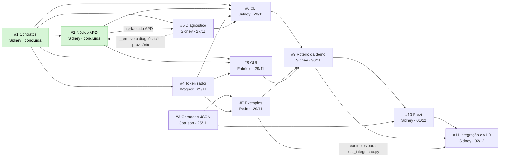

# Tarefas e cronograma

Divisão do trabalho da AV2 (Desafio 4) em **11 issues** no GitHub, a ordem em que elas
precisam ficar prontas e quem faz o quê. Os detalhes de cada tarefa (passo a passo,
especificação, testes e como entregar) estão **na própria issue**; este arquivo é o mapa geral.

- **Apresentação:** quinta-feira, **03/12/2026**, com slides no Prezi.
- **Contrato técnico:** [ARQUITETURA.md](ARQUITETURA.md) (nomes, assinaturas e convenções).
- **Definição formal:** [DEFINICAO_FORMAL.md](DEFINICAO_FORMAL.md).
- **Como usar Git e GitHub no grupo:** [CONTRIBUINDO.md](CONTRIBUINDO.md).
- **Quadro Kanban:** aba Projects do repositório.

> ## ⚠️ Regra obrigatória: todos precisam ter commits
>
> O professor vai verificar no GitHub se **cada integrante fez pelo menos 1 commit**. Por isso
> cada colega ficou com **uma única tarefa**, em **arquivos próprios** (o que também evita
> conflitos de merge): é ela que garante o seu commit. O Sidney assume o restante.
>
> - Configure o Git com o **mesmo e-mail da sua conta GitHub** antes do primeiro commit
>   (`git config --global user.email "..."`; confira em GitHub → Settings → Emails). Commit com
>   outro e-mail **não aparece** em Insights → Contributors.
> - Faça commits **você mesmo**, na sua máquina, na sua branch. Ninguém commita pelo colega.
> - Os PRs entram com **"Create a merge commit"** (não "Squash"), para preservar os commits de cada um.
> - Na integração final (#11) o Sidney confere em **Insights → Contributors** que os 5 aparecem.

> **Redistribuição (20/11):** como os colegas estão com outros projetos, cada um ficou com uma
> tarefa só e o Sidney assumiu as demais. O número das issues não mudou. As tarefas #1 e #2 já
> estão concluídas e na `main`.

## Issues

| Nº | Título | Responsável | Prazo | Depende de |
|---|---|---|---|---|
| #1 | [Núcleo] Contratos de dados (`apd/modelos.py`) | Sidney (@SidneyCirinoSF) | ✅ concluída | nada |
| #2 | [Núcleo] Classe APD e carregador (`apd/automato.py`, `apd/carregador.py`) | Sidney (@SidneyCirinoSF) | ✅ concluída | #1 |
| #3 | [Autômatos] Gerador e definições JSON dos dois APDs | Joalison (@Joalison7) | qua 25/11 | nada |
| #4 | [Tokenizador] Texto para fita de tokens (`apd/tokenizador.py`) | Wagner Daniel (@WagnerDaniell) | qua 25/11 | #1 |
| #5 | [Núcleo] Diagnóstico das rejeições (`apd/diagnostico.py`), removendo o diagnóstico provisório do `automato.py` no mesmo PR | Sidney (@SidneyCirinoSF) | sex 27/11 | #1, #2 (interface do APD) |
| #6 | [Interface] CLI com menu e passo a passo (`apd/cli.py`, `apd/__main__.py`) | Sidney (@SidneyCirinoSF) | sáb 28/11 | #1, #2, #4 (#5 para as mensagens) |
| #7 | [Testes] Exemplos de entrada e resultados esperados (`exemplos/`) | Pedro Valença (@PedroValencav2) | dom 29/11 | #3, #4 (para conferir os resultados) |
| #8 | [Interface] GUI tkinter com fita, pilha e tabela δ (`apd/gui.py`) | Fabrício (@Cibr0) | dom 29/11 | #1, #2, #4 |
| #9 | [Documentação] Roteiro da demonstração ao vivo (`docs/ROTEIRO_DEMO.md`) | Sidney (@SidneyCirinoSF) | seg 30/11 | #6, #7, #8 |
| #10 | [Apresentação] Prezi e `docs/APRESENTACAO.md` | Sidney (@SidneyCirinoSF); cada colega só apresenta a parte que fez | ter 01/12 | nada para começar; conteúdo de #3, #4, #6, #8, #9 |
| #11 | [Integração] Teste ponta a ponta (`tests/test_integracao.py`), revisão final, README e release v1.0 | Sidney (@SidneyCirinoSF) | qua 02/12 | #1 a #10 (o teste usa os exemplos do #7) |

O #7 entrega só os arquivos de entrada e os resultados esperados, **sem** teste de integração:
quem transforma esses exemplos em `tests/test_integracao.py` é o Sidney, no #11.

"Depende de" não significa "esperar parado": quase todas as tarefas podem começar já, usando
o contrato do ARQUITETURA.md e dados montados à mão. Cada issue explica como.

## Diagrama de dependências

Caminho crítico: **#5 → #6 → #9 → #10 → #11**, todo com o Sidney. O #4 (tokenizador) alimenta
a CLI, a GUI e os exemplos, e o #7 alimenta o teste de integração do #11: atraso em qualquer um
deles atrasa o grupo todo.

## Cronograma (20/11 a 03/12)

| Dia | Data | O que acontece | Marco |
|---|---|---|---|
| sex | 20/11 | Tarefas redistribuídas; #1 e #2 já estão na `main`. Todos dão `git pull`, configuram o Git e leem ARQUITETURA.md e CONTRIBUINDO.md. Joalison começa o #3; Wagner começa o #4; Pedro começa os arquivos de exemplo (#7); Fabrício esboça a GUI (#8); Sidney começa o #5 | **Núcleo pronto** (#1 e #2) |
| sáb | 21/11 | Fabrício começa as funções puras da GUI (`NavegadorPassos`) com dados montados à mão | |
| dom | 22/11 | Desenvolvimento; dúvidas de contrato vão para comentários nas issues | |
| seg | 23/11 | Pedro abre PR parcial dos exemplos (`Parte de #7`). Sidney começa a CLI (#6) com uma fita montada à mão | |
| ter | 24/11 | Desenvolvimento. Sidney compartilha o Prezi e cria o `APRESENTACAO.md` (#10) | |
| qua | 25/11 | PRs do #3 (JSON) e do #4 (tokenizador) | Autômatos e tokenizador prontos |
| qui | 26/11 | Merge do #3 e do #4. Fabrício e Sidney trocam os dados montados à mão pelo tokenizador real na GUI e na CLI | |
| sex | 27/11 | PR do #5 (diagnóstico), que já remove o diagnóstico provisório do `automato.py` | |
| sáb | 28/11 | PR do #6 (CLI) | |
| dom | 29/11 | PRs do #7 (exemplos) e do #8 (GUI) | **Interfaces prontas** |
| seg | 30/11 | PR do #9 (roteiro). Sidney começa o `tests/test_integracao.py` com os exemplos do #7 (#11) | |
| ter | 01/12 | Prezi final (#10). Depois disso só correção de bug e documentação | **Congelamento do código** |
| qua | 02/12 | Ensaio geral cronometrado no notebook do projetor (ou ter 01/12 à noite). Teste de integração, tag `v1.0` e release (#11) | **Ensaio** |
| qui | 03/12 | Apresentação | **Apresentação** |

## Quem faz o quê

| Integrante | Issues | Arquivos próprios (commits garantidos) | Seção no Prezi |
|---|---|---|---|
| **Sidney** (@SidneyCirinoSF), líder | #1 ✅, #2 ✅, #5, #6, #9, #10, #11 | `apd/__init__.py`, `apd/modelos.py`, `apd/automato.py`, `apd/carregador.py`, `apd/diagnostico.py`, `apd/cli.py`, `apd/__main__.py`, `tests/test_modelos.py`, `tests/test_automato.py`, `tests/test_carregador.py`, `tests/test_diagnostico.py`, `tests/test_cli.py`, `tests/test_integracao.py`, `docs/ROTEIRO_DEMO.md`, `docs/APRESENTACAO.md`, `README.md` | 1. Abertura e por que um AFD não basta; 4. Núcleo e diagnóstico das rejeições; 5. Zoom na pilha; 6. Demonstração ao vivo na CLI; 7. Conclusão e limitações; montagem do Prezi |
| **Joalison** (@Joalison7) | #3 | `ferramentas/gerar_automatos.py`, `automatos/xml_tags.json`, `automatos/expressoes.json`, `tests/test_automatos_json.py` | 2. Definição formal e diagrama |
| **Wagner Daniel** (@WagnerDaniell) | #4 | `apd/tokenizador.py`, `tests/test_tokenizador.py` | 3. Do texto à fita (tokenização) |
| **Pedro Valença** (@PedroValencav2) | #7 | `exemplos/` | 6. Demonstração ao vivo: casos de erro |
| **Fabrício** (@Cibr0) | #8 | `apd/gui.py`, `tests/test_gui_navegacao.py` | 6. Demonstração ao vivo na GUI |

O Prezi e o `docs/APRESENTACAO.md` ficam com o Sidney (#10); cada colega só apresenta a parte
que fez.

Revisão e merge dos PRs: **Sidney**. Os PRs do Sidney são revisados por outro integrante.

## Como cada tarefa é entregue (resumo)

1. Mover o cartão da issue para **Em andamento** no Kanban.
2. `git checkout main && git pull && git checkout -b feat/N-descricao` (ou `docs/N-...`,
   `fix/N-...`, `chore/N-...`, conforme o tipo).
3. Commits pequenos, em pt-BR, no padrão Conventional Commits:
   `feat(tokenizador): ...`, `test(cli): ...`, `docs(exemplos): ...`.
4. `git push -u origin feat/N-descricao` e abrir o Pull Request para a `main`, com o título da
   issue e `Closes #N` na descrição (ou `Parte de #N` se for um PR parcial).
5. Pedir revisão do **@SidneyCirinoSF** e mover o cartão para **Em revisão**.
6. O merge é feito com **"Create a merge commit"**. Depois dele, a issue fecha pelo `Closes #N`
   e o cartão deve ir para **Concluído**; mova o cartão manualmente se ele não mudar sozinho.

Passo a passo completo, com os comandos: [CONTRIBUINDO.md](CONTRIBUINDO.md) e a seção
"Como entregar" de cada issue.

## Convenções que todas as issues seguem

Resumo do [ARQUITETURA.md](ARQUITETURA.md) §3 e §4 (em caso de dúvida, vale o ARQUITETURA.md):

- Python 3.10+, **só biblioteca padrão**; nomes, comentários e docstrings em português.
- ε = `None` (Python) / `null` (JSON); **topo da pilha = `pilha[0]`**; `empilha[0]` vira o novo topo;
  `()` = desempilhar; `"$"` é sempre o último token da fita; aceitação **por estado final**.
- Testes com `unittest`: `python -m unittest discover -s tests -v`.
- CLI e GUI **só reexibem** `Resultado.passos`; a única implementação de δ é `APD.executar`.
